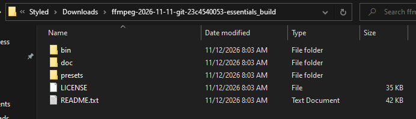
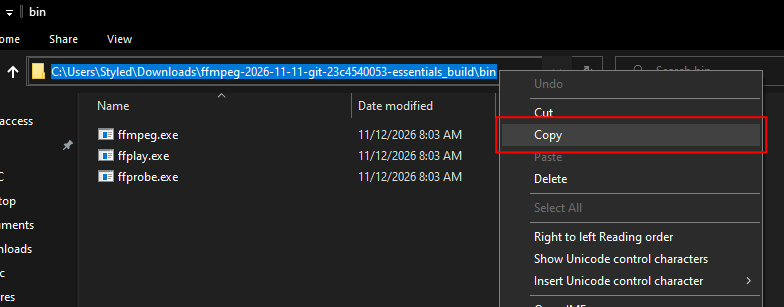
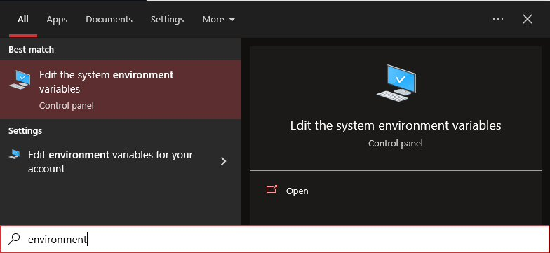
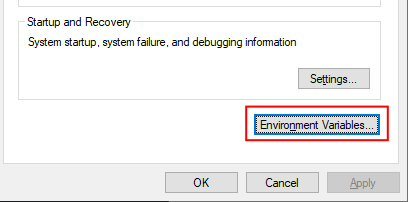
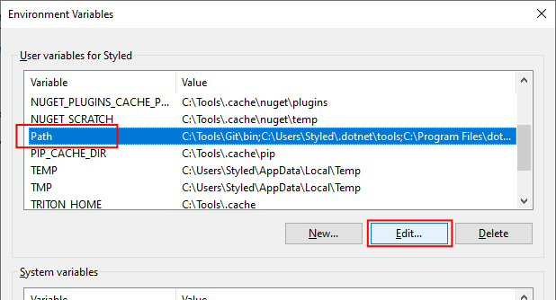
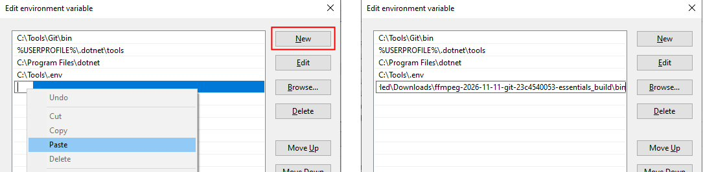

# FFMPEG

## Windows

- Download a [FFMPEG build from gyan.dev](https://www.gyan.dev/ffmpeg/builds/ffmpeg-git-essentials.7z).
- Extract using [7-Zip](https://www.7-zip.org/).
- You should get a `ffmpeg-XXXX-XX-XX-xxxxxxx...-essentials_build` folder, containing `bin`, `doc`, `presets`, etc.



- After (optionally) moving that folder to somewhere else, enter the `bin` folder.
- You should see the `ffmpeg.exe` and `ffprobe.exe`.
- Copy the directory path where those `exe`s are inside.



- Open the Start menu, and search for "environment". Look for "Edit the system environment variables".



- Click on "Environment Variables"



- Under "User variables for 'Your User Name'", find and select the Variable named "Path" on the list, then click on "Edit..."



- Click on "New". A new line will appear where you can type/paste the path you copied earlier.



- Click "OK" on all dialogs.
- If QPix Converter is already open, close it and open again.

To verify FFMPEG is set up, open a Command Prompt, type `ffmpeg -version`, and press Enter. It should print the version, copyright, and other details.

## Linux

Many distributions have `ffmpeg` on their package manager, which should add FFMPEG to the `PATH` environment variable automatically.

```sh
# Ubuntu / Debian / Linux Mint / Pop!_OS
sudo apt install ffmpeg

# Fedora
sudo dnf install ffmpeg

# Arch Linux / Manjaro / EndeavourOS
sudo pacman -S ffmpeg
```

If it's not avaiable for your distro, you can try to download [a build from FFmpeg-Builds](https://github.com/FFmpeg-Builds/FFmpeg-Builds/releases), and add the binary directory to `PATH` yourself.
