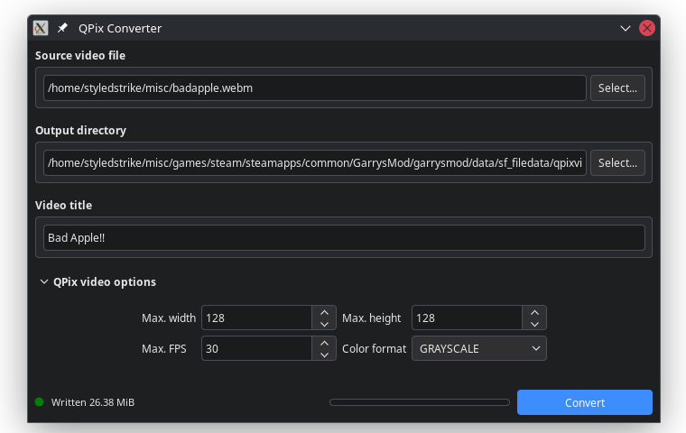

# starfall-qpix-video

QPix (silly short name for Quantized Pixels) is a basic, low-res quantized video format and pure-Lua video player for StarfallEx.

## QPixPlayer

To use the video player, you need to have [StarfallEx](https://github.com/thegrb93/StarfallEx) on Garry's Mod.

Copy the contents of the `Starfall` folder from this repository, open the Steam library folder where Garry's Mod is installed, then paste into your `GarrysMod/garrysmod/data/starfall/` folder.

In-game, open the Starfall Editor, find and open the `qpix/qpix_player.txt` script from the file browser, and follow instructions that you can find at the top of that script.

> ⚠️ Warning: Most big servers disable Lua JIT, so the the CPU usage can be a lot worse on singleplayer where it it's enabled by default.

## QPixConverter

This repository also includes a C# application to convert videos to QPix using FFMPEG.

It requires having [FFMPEG](https://ffmpeg.org/download.html) installed on your system and added into your `PATH` environment variable.



> ⚠️ Warning: Some WebM files (such as the ones downloaded with [yt-dlp](https://github.com/yt-dlp/yt-dlp)) are very slow to convert, since FFMPEG needs to count the frames one by one.

### Pre-built binaries

```TODO```

### Building

This requires having Git and [.NET SDK 10](https://dotnet.microsoft.com/en-us/download/dotnet/10.0) installed on your system.

Clone this repository, then open a terminal in the cloned directory. You can use these commands to build executables:

```sh
# Restore dependencies
dotnet restore

# Build (on Windows)
dotnet publish QPixConverter/QPixConverter.csproj --configuration Release --runtime win-x64 --self-contained true

# Build (on Linux)
dotnet publish QPixConverter/QPixConverter.csproj --configuration Release --runtime linux-x64 --self-contained true
```

You can find the built binaries on `artifacts/publish/QPixConverter/release_(platform)/`.
